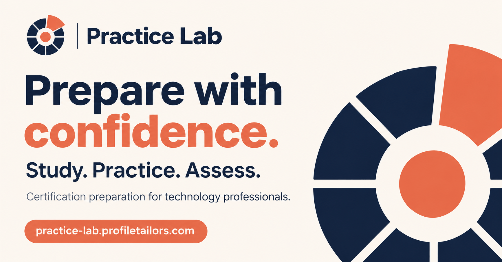

# Practice Lab

Interactive practice platform for certification preparation. Study by domain, take timed mock exams,
and track your progress. Quiz progress is saved in browser IndexedDB; the site itself needs an
internet connection to load.



[](https://opensource.org/licenses/MIT)

## Available Certifications

| Certification | Description                               | Bank | Domains | Mock exam |
| ------------- | ----------------------------------------- | ---- | ------- | --------- |
| **CCDV-F**    | Claude Developer Foundations              | 199  | 8       | 53        |
| **CCDV-P**    | Claude Certified Developer — Professional | 70   | 8       | 70        |
| **CCAO-F**    | Claude Certified Associate — Foundations  | 109  | 7       | 50        |
| **CCAR-P**    | Claude Certified Architect — Professional | 58   | 7       | 50        |
| **CCAR-F**    | Claude Certified Architect — Foundations  | 60   | 5       | 50        |

Mock exam counts and durations are Practice Lab settings, not live exam blueprints. CCDV-P's live
exam has 70 items (60 scored and 10 unscored) in 120 minutes; the Practice Lab mock scores all 70
questions. CCAO-F's live exam has 60 items in 120 minutes, while the Practice Lab mock uses 50
questions in 100 minutes. A raw mock percentage does not predict the CCDV-P scaled score.

## Features

- **Practice mode** — study question by question with explanations and sources.
- **Exam mode** — timed mock exam with certification-specific question counts and durations.
- **Weaknesses mode** — focus on the questions you got wrong.
- **Progress tracking** — statistics, resumable sessions, and results persist in browser `IndexedDB`
  on this origin.
- **Search** — the accessible search dialog matches result metadata and full-text study-note
  content; structurally identified assessment answers are omitted from its generated index.
- **Study library** — per-certification study notes rendered from Markdown, organised by exam domain
  with a table of contents and cross-links.

## Content Sources and Attribution

Some CCAO-F, CCAR-P, and CCAR-F practice questions and 53 of the 199 CCDV-F questions come from
[Cert Pro Quest](https://cert-pro-quest.lovable.app/) by Matthew Purcell. They are community-created
practice questions, not official exam content.

The CCAO-F bank also includes 49 adapted questions from the TestApp author's separate
Claude-generated practice set. The maintainer confirmed reuse permission; the author's name was not
provided. No SkillCertPro questions or cheat-sheet text are included.

The CCDV-P bank includes 70 adapted questions from Matthew Purcell's _Claude Certified Developer —
Professional: Full Practice Exam Question Set_, licensed under [CC BY-NC 4.0](https://creativecommons.org/licenses/by-nc/4.0/).
They are published here for noncommercial personal study and are not official exam items. The
application's MIT license does not apply to third-party content. See [`NOTICE`](NOTICE) for
attribution, modifications, and licensing boundaries.

## Stack

- [Astro](https://astro.build) — static site framework.
- TypeScript — full type safety.
- Native CSS — no preprocessors or UI frameworks.
- IndexedDB — versioned quiz progress, active sessions, and history.
- `localStorage` — theme preference and read-only legacy progress during migration.

## Browser Progress, Migration, and Recovery

Quiz progress stays in the current browser profile and site origin; it is not synchronized to a
server or between deployments. Certification pages offer versioned JSON backups that can be restored
for the certification currently open. Before importing a legacy record, the page also offers a
backup of known legacy records and IndexedDB progress; the original legacy key is retained. For
migration, rollback, stale-tab reconciliation, reset, and restore behavior, see [
`docs/progress-storage.md`](docs/progress-storage.md).

## Project Structure

```
/
├── public/                  # Static assets
├── scripts/
│   ├── scrape-cert-pro-quest.mjs  # Scraper for Cert Pro Quest
│   ├── generate-cpq-banks.mjs     # Generator for imported question banks
│   └── lib/
│       └── cpq-normalize.mjs      # Normalization utilities
├── src/
│   ├── certifications/      # Config and questions per certification
│   │   ├── ccdv-f/
│   │   │   ├── config.ts    # Exam blueprint, domains, theme
│   │   │   └── questions.ts # Question bank
│   │   ├── ccdv-p/
│   │   ├── ccao-f/
│   │   └── index.ts         # Certification registry
│   ├── components/          # Astro components
│   ├── layouts/             # Reusable layouts
│   ├── lib/                 # Quiz engine and types
│   ├── pages/               # Application routes
│   └── styles/              # Global styles
├── astro.config.mjs
└── package.json
```

### Regenerating the imported banks

The imported Cert Pro Quest banks are generated from a source snapshot. The generator overwrites the
files it owns and does not merge later hand-maintained content. The 49 TestApp-generated CCAO-F
questions and the corrected CCAO-F guide metadata are not in that snapshot. Do not regenerate the
CCAO-F bank until the workflow preserves those additions.

To regenerate the Cert Pro Quest snapshot outputs:

1. Update the snapshot: `node scripts/scrape-cert-pro-quest.mjs`
2. Regenerate banks: `node scripts/generate-cpq-banks.mjs`

The generator automatically formats its output with the project's Biome, so no manual formatting
step is required.

## Adding a New Certification

The registry auto-discovers certifications from `src/certifications/<slug>/`. Create a directory
with two files:

1. `config.ts` — export a `config` constant of type `CertificationConfig` with the exam blueprint,
   domains, and theme.
2. `questions.ts` — export a `questions` array of type `Question[]` with the question bank.

No manual registration is required; both files are loaded at build time via `import.meta.glob`.

## Study Notes

Study notes live in `src/content/study/<slug>/` as Markdown files. The CCDV-F library is synced from
an Obsidian vault by running:

```
pnpm sync:study
```

The default vault path is the Claude Certified Developer folder in iCloud and can be overridden with
the `STUDY_SOURCE` environment variable. The script copies CCDV-F - Base de conocimiento, MSO
Foundations, and the vault root notes, converts wikilinks to relative links, strips the leading H1,
injects a title when missing, converts Obsidian callouts, and copies the exam guide PDF to
`public/study/ccdv-f/`.

CCAO-F and CCDV-P use maintained, modular Markdown notes with source registers; `pnpm sync:study`
does not populate those libraries. The `src/content/study` directory is excluded from Biome
formatting because it mirrors an external source. The study routes are `/study/`, `/study/<cert>/`,
and `/study/<cert>/<slug>/`.

### Search indexing policy

Study-note search indexes readable Markdown body text while omitting answer sections with an
explicit `Answer key` heading or a combined heading such as `Answers and rationales`, including
nested subsections. Generic technical headings named `Answers`, `Rationales`, or `Solutions` remain
searchable. It also omits a marked answer or rationale paragraph directly after a Markdown block
containing at least two labeled A–D options, plus continuation paragraphs through the next Markdown
heading, recognizable question-prompt marker, or multiple-choice options block. Question prompts,
`Check your understanding` tasks, ordinary technical explanations, and content outside those
structural boundaries remain searchable.

The current CCDV-F inventory includes original practice questions with `- A.` through `- D.` options
followed by a `Best answer:` rationale, plus the imported
`ccdv-f-developer-study-guide-100-questions.md`, whose nested answer section is headed
`Answer key, rationales and primary references` and contains domain-level bullet keys. These formats
are excluded structurally without removing question prompts or content in later headings. After a
marked rationale, unheaded paragraphs are treated as part of that rationale until the documented
boundary; put instructional material intended for search under a new heading or after another
options block.

This is a learning-experience control, not an anti-cheating or security boundary: study notes remain
publicly accessible on their pages. Only the documented heading and multiple-choice formats are
recognized, so differently formatted answer material may still appear in search results.

Each question follows this structure:

```ts
{
  id: "q001",
      domain
:
  "D1",
      topic
:
  "Topic name",
      question
:
  "¿Pregunta?",
      options
:
  ["Option A", "Option B", "Option C", "Option D"],
      correctAnswers
:
  [0],
      explanation
:
  "Explanation of the correct answer.",
      source
:
  {
    label: "Source", url
  :
    "https://..."
  }
}
```

## Commands

| Command           | Action                                   |
| ----------------- | ---------------------------------------- |
| `pnpm install`    | Install dependencies                     |
| `pnpm dev`        | Start dev server at `localhost:4321`     |
| `pnpm build`      | Generate production build in `./dist/`   |
| `pnpm preview`    | Preview the build locally                |
| `pnpm sync:study` | Sync study notes from the Obsidian vault |

## Requirements

- Node.js >= 22.23.4
- pnpm

## License

MIT
